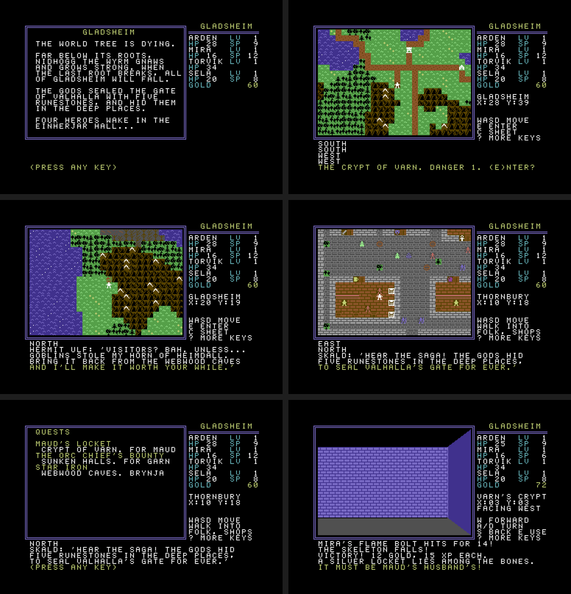

# Gladsheim — a C64 RPG

An Ultima II–style overworld and towns with Bard's Tale–style first-person dungeons for the
Commodore 64. Party of four, experience levels 1–20, six dungeons on eleven floors, two towns with
shops and people to talk to, six side quests, a puzzle in every dungeon, and a final boss behind five
runestones. Keyboard only.

The world is **Gladsheim**, the realm of Norse myth where Valhalla stands. Four heroes set out from
the Einherjar Hall to win the five runestones that open Valhalla's Gate, where Nidhogg, the wyrm
that gnaws at the World Tree, waits at the bottom.

## Run

Prebuilt images are in `dist/` (`gladsheim.d64`, `gladsheim.prg`); `./build.sh` makes fresh ones in `build/`.

- **VICE:** `x64sc -autostart dist/gladsheim.d64`
- **Real hardware / SD2IEC / Ultimate:** `LOAD"GLADSHEIM",8` then `RUN`

The game is crunched with Exomizer: 72 blocks instead of 170, so it loads in well under half the
time on a stock 1541; it unpacks itself in a few seconds.

## Saving

Out on the overworld, **V** saves and **L** loads. The game writes one file, `GLADSHEIM SAVE`, to the
disk in drive 8 (replacing the old one): the party, gold, runestones, keys and the state of every
dungeon floor. Use a writable copy of the disk image. Write-protect and disk errors are reported.

## Controls

| Overworld / town | Dungeon | Combat (each member) | Shop |
|---|---|---|---|
| W A S D / cursor keys — move | W — forward | A — attack | A–D — choose item |
| E — enter dungeon or town | Q / D (or cursor keys) — turn, S — about face | P — parry (halve damage) | 1–4 — who gets it |
| walk into people, signs, counters | E — stairs, levers | H — heal: then 1–4, or RETURN for the most hurt | X — leave |
| C — character sheet, J — quest journal | C — sheet, J — quest journal | B — the wizard's flame bolt | |
| H — the paladin heals (1–4, RETURN = most hurt) | H — paladin heals | S — the bard's song (heals all) | |
| V — save, L — load (overworld) | | | |
| | walk into doors | R — run (50%) | |

## People and side quests

Townsfolk remember what you have done: what they say changes as quests move on and as runestones are
won. Each person's lines are a short list of pages with conditions (a quest's stage, the number of
runestones, one runestone in particular) and actions (set a quest's stage, gold, experience, a weapon,
a spell upgrade), written in `content.py`. **J** (journal) shows every quest you have heard of and where it stands.

| Quest | Given by | Where | Reward |
|---|---|---|---|
| Maud's locket | Maud, Thornbury | Crypt of Varn | 60 gold, 40 XP |
| The orc chief's bounty | Captain Garn, Thornbury | Sunken Halls (slay the Orc Chief) | 150 gold |
| Star iron | Brynja, the smith's daughter, Thornbury | Webwood Caves, lower floor | the Starblade for Torvik |
| The horn of Heimdall | Ulf, the hermit in his hut in the wilds | Webwood Caves, upper floor | Sela's song grows stronger |
| Brok's fate | Hilde, Ravenmoor | Frozen Deep | 400 gold, 200 XP |
| The flame codex | Sage Elra, Ravenmoor | Obsidian Keep, upper floor | Mira's flame bolt grows stronger |

Mayor Brandt rewards the first and third runestones. Items can be found before anyone asks for them;
take them back and they still count.

## Making the party

A new game tells the story so far, then asks for a new party or a saved game. Each of the four
heroes (paladin, wizard, fighter, bard) gets a name of up to seven letters (RETURN keeps the
default) and a roll of hit points, spell points and might: **R** rolls again, RETURN keeps it.
Names are kept in saved games.

## The party and levelling

| | Class | Grows per level | Special |
|---|---|---|---|
| Arden | Paladin | +4–6 HP, +2 SP, +1 might | Heal: 6–13 + 2×level + tome |
| Mira | Wizard | +2–4 HP, +4 SP | Flame bolt: 6–13 + 2×level + tome, **ignores armour** |
| Torvik | Fighter | +5–7 HP, +1 might | Biggest hitter |
| Sela | Bard | +3–5 HP, +2 SP, +1 might | Song: heals everyone 1–4 + level/2 + lute |

Every survivor of a fight earns its full experience. Weapon hits do 1–weapon + might, minus the
monster's armour; hit chance improves with level. Armour subtracts from every blow you take.
If the whole party falls, it wakes in the Einherjar Hall with half its gold gone — dungeon progress
(doors opened, bosses slain, runestones) is kept.

## The world

| | Place | Danger | Puzzle | Boss |
|---|---|---|---|---|
| 1 | Crypt of Varn | 1 | a magic mouth asks the dead king's name (typed answer) | Bone King |
| 2 | Sunken Halls | 2 | three levers, in the right order | Orc Chief |
| 3 | Webwood Caves (2 floors) | 3 | find the key on the floor above the locked lair | Spider Queen |
| 4 | Frozen Deep (2 floors) | 4 | an illusory wall; light four rune plates | Frost Troll |
| 5 | Obsidian Keep (2 floors) | 5 | iron, bone, gold levers; name the first flame | Death Knight |
| 6 | Valhalla's Gate (3 floors) | 6 | sealed by the five runestones; rune plates, illusions, a key | Nidhogg |

Dungeons get harder the farther they are from the Einherjar Hall. Each boss guards a chest holding
one of the five runestones. Clues are carved in the dungeons, rumoured in taverns, and told by townsfolk.

**Thornbury** (beside the Einherjar Hall) sells starter gear; **Ravenmoor** (the eastern frontier, by the ash
lands) sells masterwork weapons and armour, higher tomes, and blessings (+max HP). Both have an inn
(HP and SP), a temple (cure, raise dead), and a tavern full of rumours.

17 monster types drawn as 2×2 multicolour sprite portraits: skeletons, slimes, goblins, orcs,
giant spiders, wraiths, trolls, dark knights, cultists, liches, drakes, and six bosses.

## Build and test

Needs Python 3 and [ACME](https://sourceforge.net/projects/acme-crossass/); [Exomizer](https://bitbucket.org/magli143/exomizer/wiki/Home)
to crunch the disk version (optional: without it `build.sh` puts the plain program on the disk);
Pillow and ffmpeg for previews and video.

    ./build.sh                               # gen.py -> acme -> exomizer -> build/gladsheim.d64
    python3 tools/playtest.py --seed 0x1234  # a bot plays the ENTIRE game, asserting state
    python3 tools/highlights.py out.mp4      # full playthrough as a highlight reel

The emulator in `tools/sim.py` includes a small fake 1541 (SETNAM, SETLFS, OPEN, LOAD, SAVE and the
error channel) so saving and loading are tested too. The bot only presses keys. It reads emulated memory to see the map, solves every puzzle, shops,
rests at inns, retreats when hurt, trains when under-levelled, finishes all six side quests and kills the Wyrm. Across a dozen
random seeds it finishes the game in 170–220 battles, typically with 0–2 party wipes.

## How it fits

**Hires bitmap mode.** The whole screen is a 320×200 bitmap with two colours (any of the 16) per
8×8 cell, the way *Bard's Tale* and *Ultima IV* look on the C64. The game itself draws into two
small in-memory layers, and a compositor (`render.asm`) turns only what changed into pixels each
time the game waits for a key:

- a **graphics layer**, 40×25 glyph codes: map tiles, dungeon wall pieces, the frame;
- a **text layer**, 40×25 characters in an 8×8 font, used for the side panel, messages, shops,
  dialogue and the character sheet.

The overworld and towns show 26×18 tiles of 8×8 pixels; in towns the view stops at the walls so the
whole town fits. Grass, water, forest, mountains, snow, ash, dead wood and roads each have two to four
looks, picked per square from a fixed pseudo-random pattern, so the land doesn't tile. The 3D dungeon
view fills the whole 26×18 window with true one-pixel diagonals. Stairs, chests, keys, levers, rune plates
and quest items show on the floor of the square you stand on and the two ahead.

| Range | Contents |
|---|---|
| `$0400–$07E7` | graphics layer (glyph codes) |
| `$0801–$1FFF` | engine core, compositor, quest engine |
| `$2000–$29FF` | monster portraits as loaded (copied to `$C400` at start), then the last-presented graphics, the text layer and its colours |
| `$2C00–$37FF` | dialogue |
| `$3800–$3FFF` | 256 hires glyphs: font, frame, 36 map tiles and 15 terrain variants, dungeon wall pieces |
| `$4000–$4FFF` | 64×64 overworld |
| `$5000–$57FF` | two 32×32 town maps |
| `$5800–$58FF` | game state, quest stages included · `$5A00` current dungeon floor · `$5B00` row redraw flags |
| `$5C00–$5FFF` | people's pages, quest tables, the opening story |
| `$6000–$B3FF` | combat, towns, panel, sheet, save/load, generated tables, 11 pristine floors, text (RAM under BASIC from `$A000`) |
| `$B400–$BFFF` | saved state of every floor + a copy of the game state = the `GLADSHEIM SAVE` file |
| `$C000–$C3FF` | colour matrix (VIC bank 3) and sprite pointers |
| `$C400–$CDFF` | monster portraits |
| `$E000–$FF3F` | the bitmap (RAM under the KERNAL ROM) |

**Content is data.** `content.py` holds every monster, floor, town, shop and line of dialogue;
`gen.py` turns it into assembler tables and validates it: every floor is solvable (puzzle pieces
reachable before their door, bosses impossible to walk around, keys above the doors that need them),
every town shop and person reachable, every quest item where a quest expects it, every line fits its window. The nine newer floors are seeded
mazes with puzzle pieces placed under those rules.

## Files

- `main.asm` — engine core · `combat.asm` — combat, experience, levels · `town.asm` — towns and shops
- `sheet.asm` — character sheet and ending · `text.asm` — engine messages · `saveload.asm` — disk saves
- `render.asm` — the bitmap compositor · `panel.asm` — side panel and help · `quest.asm` — people, quests, story
- `hires.py` — tile, terrain-variant and wall art
- `content.py` — the game's content · `art.py` — monster portraits · `gen.py` — data generator
- `tools/sim.py` — 6502 + VIC-II renderer · `tools/playtest.py` — full-game bot
- `tools/highlights.py` — video · `tools/romcheck.py` — checks the crunched program unpacks byte-exact
- `tools/artpreview.py`, `tools/mockup.py`, `tools/d64.py`, `tools/tiles.py`, `tools/townview.py` — utilities

## License

MIT — see [LICENSE](LICENSE). Exomizer (used only at build time, not included) is by Magnus Lind.
