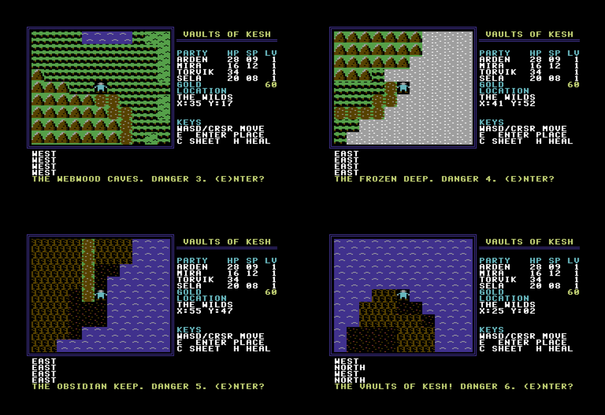
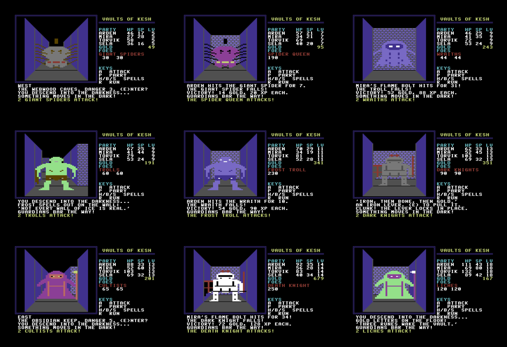

# Vaults of Kesh — C64 RPG (v4)

An Ultima II–style overworld and towns with Bard's Tale–style first-person dungeons for the
Commodore 64. Party of four, experience levels 1–20, six dungeons on eleven floors, two towns with
shops, a puzzle in every dungeon, and a final boss behind five sigils. Keyboard only.

## Run

Prebuilt images are in `dist/` (`vaults_of_kesh.d64`, `vaults_of_kesh.prg`); `./build.sh` makes fresh ones in `build/`.

- **VICE:** `x64sc -autostart dist/vaults_of_kesh.d64`
- **Real hardware / SD2IEC / Ultimate:** `LOAD"VAULTS OF KESH",8` then `RUN`

The game is crunched with Exomizer: 58 blocks instead of 149, so it loads in well under half the
time on a stock 1541; it unpacks itself in about four seconds.

## Saving

Out on the overworld, **V** saves and **L** loads. The game writes one file, `KESH SAVE`, to the
disk in drive 8 (replacing the old one): the party, gold, sigils, keys and the state of every
dungeon floor. Use a writable copy of the disk image. Write-protect and disk errors are reported.

## Controls

| Overworld / town | Dungeon | Combat (each member) | Shop |
|---|---|---|---|
| W A S D / cursor keys — move | W — forward | A — attack | A–D — choose item |
| E — enter dungeon or town | A / D — turn, S — about face | P — parry (halve damage) | 1–4 — who gets it |
| walk into people, signs, counters | E — stairs, levers | H — Arden heals | X — leave |
| C — character sheet | C — character sheet | B — Mira's flame bolt | |
| H — Arden heals (outside combat) | H — Arden heals | S — Sela's song (heals all) | |
| V — save, L — load (overworld) | | | |
| | walk into doors | R — run (50%) | |

## The party and levelling

| | Class | Grows per level | Special |
|---|---|---|---|
| Arden | Paladin | +4–6 HP, +2 SP, +1 might | Heal: 6–13 + 2×level + tome |
| Mira | Wizard | +2–4 HP, +4 SP | Flame bolt: 6–13 + 2×level + tome, **ignores armour** |
| Torvik | Fighter | +5–7 HP, +1 might | Biggest hitter |
| Sela | Bard | +3–5 HP, +2 SP, +1 might | Song: heals everyone 1–4 + level/2 + lute |

Every survivor of a fight earns its full experience. Weapon hits do 1–weapon + might, minus the
monster's armour; hit chance improves with level. Armour subtracts from every blow you take.
If the whole party falls, it wakes at the Keep of Kesh with half its gold gone — dungeon progress
(doors opened, bosses slain, sigils) is kept.

## The world

| | Place | Danger | Puzzle | Boss |
|---|---|---|---|---|
| 1 | Crypt of Varn | 1 | a magic mouth asks the dead king's name (typed answer) | Bone King |
| 2 | Sunken Halls | 2 | three levers, in the right order | Orc Chief |
| 3 | Webwood Caves (2 floors) | 3 | find the key on the floor above the locked lair | Spider Queen |
| 4 | Frozen Deep (2 floors) | 4 | an illusory wall; light four rune plates | Frost Troll |
| 5 | Obsidian Keep (2 floors) | 5 | iron, bone, gold levers; name the first flame | Death Knight |
| 6 | Vaults of Kesh (3 floors) | 6 | sealed by the five sigils; runes, illusions, a key | Kesh the Wyrm |

Dungeons get harder the farther they are from the keep. Each boss guards a chest holding one of the
five sigils. Clues are carved in the dungeons, rumoured in taverns, and told by townsfolk.

**Thornbury** (beside the keep) sells starter gear; **Ravenmoor** (the eastern frontier, by the ash
lands) sells masterwork weapons and armour, higher tomes, and blessings (+max HP). Both have an inn
(HP and SP), a temple (cure, raise dead), and a tavern full of rumours.

17 monster types drawn as 2×2 multicolour sprite portraits: skeletons, slimes, goblins, orcs,
giant spiders, wraiths, trolls, dark knights, cultists, liches, drakes, and six bosses.

## Build and test

Needs Python 3 and [ACME](https://sourceforge.net/projects/acme-crossass/); [Exomizer](https://bitbucket.org/magli143/exomizer/wiki/Home)
to crunch the disk version (optional: without it `build.sh` puts the plain program on the disk);
Pillow and ffmpeg for previews and video.

    ./build.sh                               # gen.py -> acme -> exomizer -> build/kesh.d64
    python3 tools/playtest.py --seed 0x1234  # a bot plays the ENTIRE game, asserting state
    python3 tools/highlights.py out.mp4      # full playthrough as a highlight reel

The emulator in `tools/sim.py` includes a small fake 1541 (SETNAM, SETLFS, OPEN, LOAD, SAVE and the
error channel) so saving and loading are tested too. The bot only presses keys. It reads emulated memory to see the map, solves every puzzle, shops,
rests at inns, retreats when hurt, trains when under-levelled and kills the Wyrm. Across a dozen
random seeds it finishes the game in 170–220 battles, typically with 0–2 party wipes.

## How it fits

| Range | Contents |
|---|---|
| `$0801–$188D` | engine core: overworld, towns' walking, 3D renderer, dungeon logic, screen I/O |
| `$2000–$29FF` | 10 monster portraits (40 sprites) |
| `$2A00–$368C` | engine text, character sheet, ending |
| `$3800–$3FFF` | charset: font, frame, 32 terrain/town tiles, dungeon wall pieces |
| `$4000–$4FFF` | 64×64 overworld |
| `$5000–$57FF` | two 32×32 town maps |
| `$5800–$58FF` | game state |
| `$5A00–$5AFF` | current dungeon floor |
| `$6000–$9BBE` | combat, towns, save/load, generated tables, 11 pristine floors, content text |
| `$C000–$C3FF` | 3D view buffers |
| `$C400–$CEFF` | saved state of every floor |
| `$CF00–$CFFF` | copy of the game state, written to disk with the floors as `KESH SAVE` |

**Content is data.** `content.py` holds every monster, floor, town, shop and line of dialogue;
`gen.py` turns it into assembler tables and validates it: every floor is solvable (puzzle pieces
reachable before their door, bosses impossible to walk around, keys above the doors that need them),
every town shop and person reachable, every line fits its window. The nine newer floors are seeded
mazes with puzzle pieces placed under those rules.

## Files

- `main.asm` — engine core · `combat.asm` — combat, experience, levels · `town.asm` — towns and shops
- `sheet.asm` — character sheet and ending · `text.asm` — engine messages · `saveload.asm` — disk saves
- `content.py` — the game's content · `art.py` — monster portraits · `gen.py` — data generator
- `tools/sim.py` — 6502 + VIC-II renderer · `tools/playtest.py` — full-game bot
- `tools/highlights.py` — video · `tools/d64.py`, `tools/tiles.py`, `tools/townview.py` — utilities

## License

MIT — see [LICENSE](LICENSE). Exomizer (used only at build time, not included) is by Magnus Lind.
